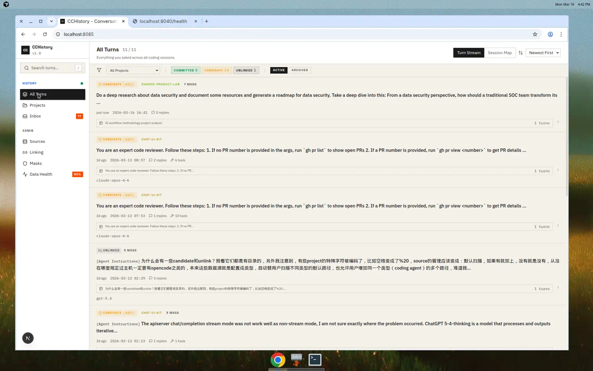
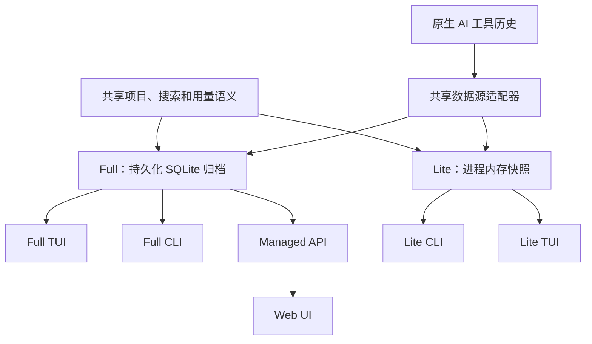
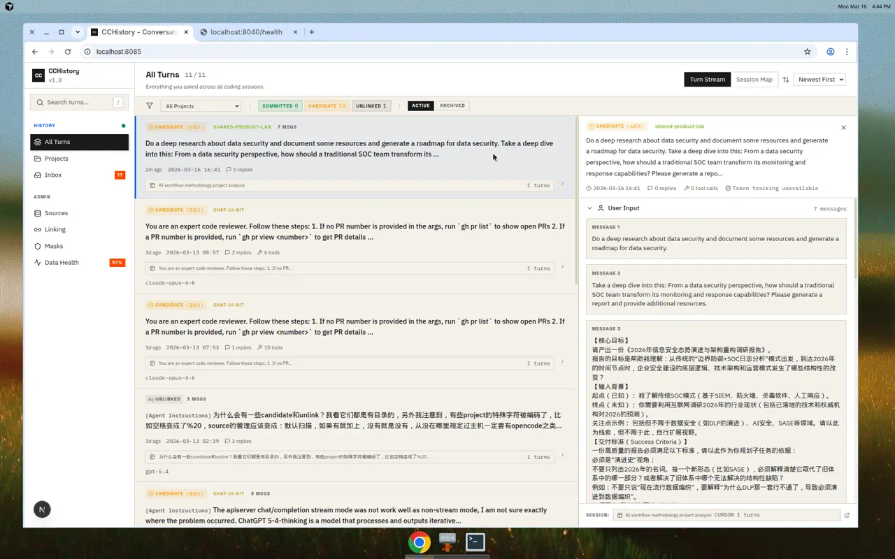
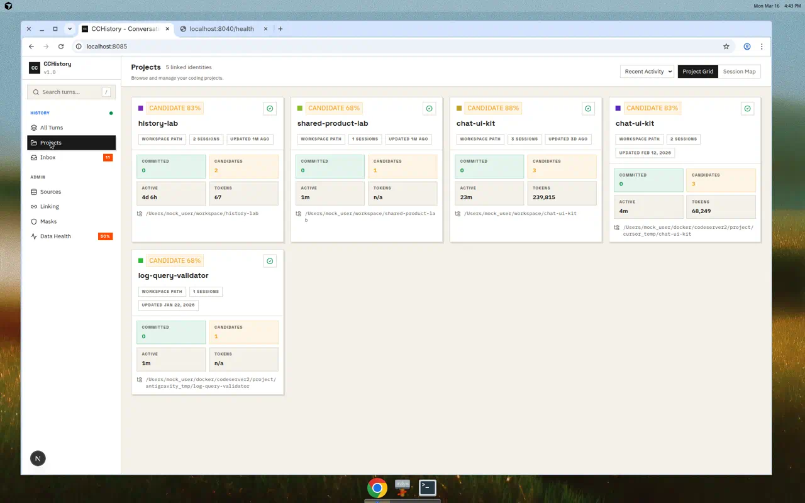
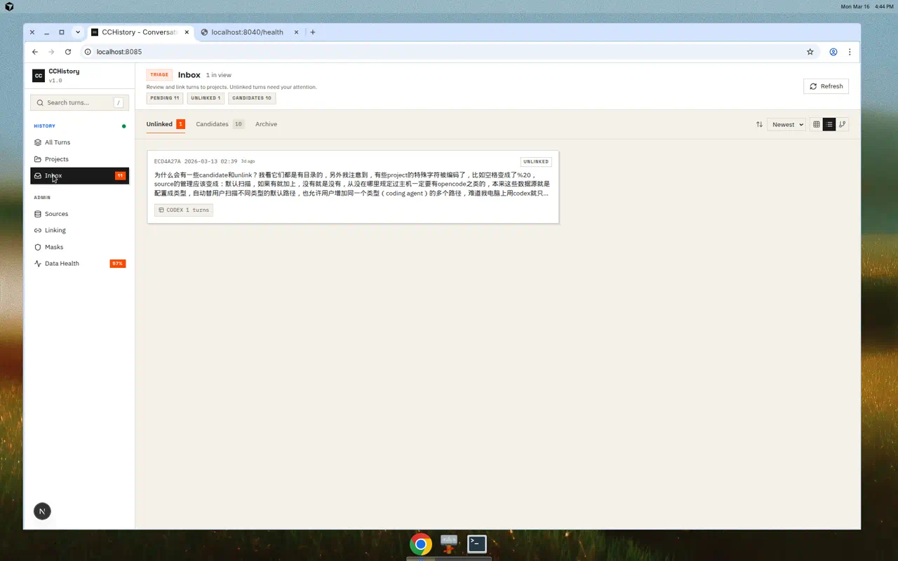
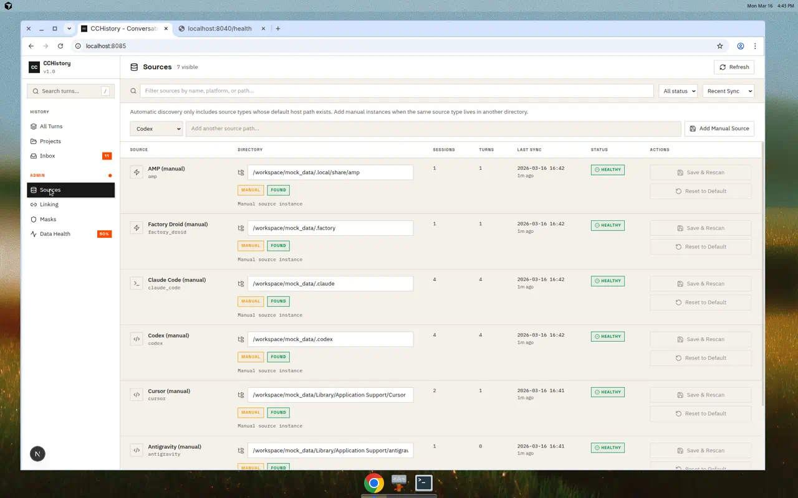
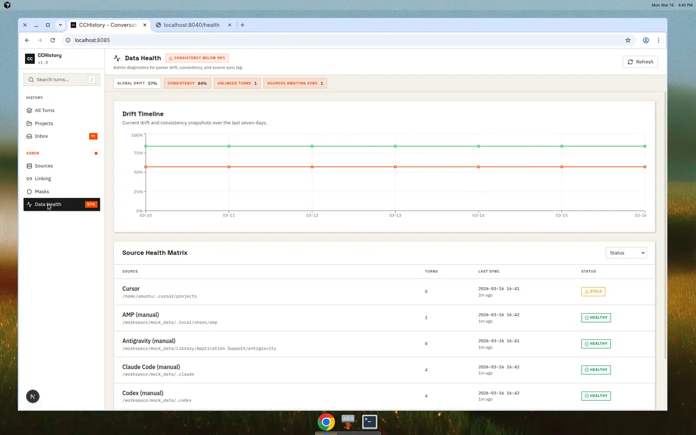

<p align="center">
  <strong>CCHistory</strong><br>
  <em>按项目找回你的 AI 编程对话</em>
</p>

<p align="center">
  =22" />
  
  
  
  
</p>

<p align="center">
  <a href="README.md">English</a> | 简体中文
</p>

---

CCHistory 把本机不同工具中的 AI 编程历史按项目整理，帮助你找回以前的提问、
查看完整对话，并回顾跨工具的工作过程。它从 **14 个 AI 编程助手平台（包括
Claude Code、Cursor、Codex、AMP、Gemini CLI、Kimi Code、Accio Work、ZCode 等）**
读取本地历史，其中 10 个适配器为稳定支持，4 个为实验性支持，详见[支持平台](#支持平台)。

每次用户提问对应一个 `UserTurn`，关联项目、会话、助手回复、工具调用和源证据。
Full 保存可持续同步、备份的历史归档；Lite 直接读取原生历史，只在进程内保留快照。
两者共用适配器，以及规范化的项目关联、搜索和用量统计语义。

<p align="center">
  
</p>

## 从这里开始

| 目标 | 使用入口 |
|------|----------|
| 同步本地工具历史、检查数据健康 | [`cchistory sync`](docs/guide/cli.md#sync)、[`cchistory health`](docs/guide/cli.md#health) |
| 找回以前的提问、查看对应对话 | [Full TUI](docs/guide/tui.md)、[Web](docs/guide/web.md) 或 [Lite TUI](docs/guide/lite.md#lite-tui-navigation) |
| 给 AI agent 提供项目上下文 | [`cchistory context project <ref>`](docs/guide/cli.md#context) |
| 直接浏览原生历史，不创建或读取 Full store | [Lite 指南](docs/guide/lite.md)、`cchistory-lite`、`cchistory-lite-tui` |
| 备份、恢复或迁移归档 | [CLI 备份与恢复指南](docs/guide/cli.md#backup-and-restore) |
| 了解平台支持与解析覆盖 | [文档地图](docs/README.md)、[运行时清单](docs/design/CURRENT_RUNTIME_SURFACE.md)、[数据源说明](docs/sources/README.md) |

### 选择 Full 还是 Lite

| | Full | Lite |
|---|---|---|
| 适合场景 | 持续保存、同步历史，或合并导入的归档 | 浏览一台机器上已有的原生历史 |
| 数据保存 | SQLite store，独立保留原始源证据 | 就地读取原生数据，退出后释放内存快照 |
| 阅读入口 | Full TUI；可选 Web/API | Lite TUI 和单次运行的 Lite CLI |
| 管理能力 | 同步、备份、导入、合并和显式清理 | 浏览、搜索、统计和单向规范化导出 |
| 构建命令 | `pnpm run build` | `pnpm run build:lite` |

Full TUI 和两个 Lite 入口均可独立运行，无需启动 API 或 Web。
需要浏览器访问时，再构建和启动 Managed Web/API profile。

## 核心特性

- **多平台采集** — 通过已注册的本地 source adapter、本地文件解析以及必要时的应用内实时探测收集对话数据
- **证据保全** — 原始证据被完整保留并可追溯；每个 `UserTurn` 都从源数据派生，绝不直接手动创建
- **基于项目的关联** — 通过仓库指纹、工作空间路径和手动覆盖将对话轮次关联到项目
- **面向 AI 的项目上下文** — `cchistory context project <ref>` 可跨会话给出近期提问、会话线程和下一步检查命令
- **全文搜索** — 在所有规范化对话文本中搜索，支持按项目和数据源过滤
- **四个一致的 Full 入口** — TUI 和 Web 是面向用户的读取入口；CLI 和 API 是管理、自动化与集成入口
- **零存储 Lite profile** — 与 Full 共用 adapter、`UserTurn`/context 推导、项目关联、搜索和统计，只在单机进程内保留快照，并提供独立 CLI/TUI 与单向导出
- **Token 用量分析** — 跨模型、项目、数据源和时间维度追踪 Token 用量
- **导出 / 导入 / 合并** — 可移植的数据包，用于备份、迁移和多主机合并
- **数据健康监控** — 漂移和一致性指标，配有数据源级别的健康矩阵

## v0.3.0 之后的开发进展

开发分支已加入：

- **CC History Lite** — 独立 CLI 和键盘操作 TUI，支持项目、会话、提问浏览，
  搜索、统计，以及按需加载完整会话上下文。
- **完整规范化文本召回** — 长提问超过原来的 16 KiB 扫描边界后仍可搜索；
  仅存在于原始文本中的已屏蔽内容不进入召回。
- **减少重复工作** — 未变化的文件复用已有解析结果；读取索引就绪后，
  分页和单条详情只加载所需轮次。
- **保留已消失源的历史** — 完整扫描把缺失源文件标记为 absent，同时保留证据；
  原始数据包导出可使用经过校验的归档捕获。
- **改进 CLI 工作流** — 按路径定位项目、写操作先预览，并捕获问答工具交互。
  详见 [CLI 指南](docs/guide/cli.md)。

## 发布范围

[`v0.3.0`](https://github.com/aaaAlexanderaaa/cchistory/releases/tag/v0.3.0) 是最新已打标签的版本。
`master` 包含上述后续开发改动；正式升级版本号前，package、API 和 UI 版本标记仍为 `0.3.0`。
设计文档中的
`self-host v1` 指的是支持和部署范围：单用户、本地优先、SQLite 存储、
localhost 或可信 LAN 部署。它不是 package semver。

每个 source adapter 的支持分级以
[`packages/source-adapters/src/platforms/registry.ts`](packages/source-adapters/src/platforms/registry.ts)
为准，并由 `pnpm run verify:support-status` 校验。

## 支持平台

| 平台 | Self-host v1 分级 | 数据源位置 |
|------|-------------------|-----------|
| Codex | **Stable** | `~/.codex/sessions/` |
| Claude Code | **Stable** | `~/.claude/projects/` |
| Cursor | **Stable** | 平台用户数据 + 项目历史 |
| AMP | **Stable** | `~/.local/share/amp/threads/` |
| Factory Droid | **Stable** | `~/.factory/sessions/` |
| Antigravity | **Stable** | 平台用户数据 `User/` + `~/.gemini/antigravity/{conversations,brain}` |
| OpenClaw | **Stable** | `~/.openclaw/agents/` |
| OpenCode | **Stable** | `~/.local/share/opencode/{project,storage}` |
| Gemini CLI | **Stable** | `~/.gemini/` |
| LobeChat | Experimental | `~/.config/lobehub-storage/` |
| CodeBuddy | **Stable** | `~/.codebuddy/` |
| Accio Work | Experimental | `~/.accio/accounts/` |
| ZCode | Experimental | `~/.zcode/` |
| Kimi Code | Experimental | `~/.kimi-code/` |

> `Stable` 表示已经达到 self-host v1 的真实世界验证门槛。`Experimental` 表示 adapter 已经注册到代码里，但还没有足够的真实样本验证，不能作为 self-host v1 的正式支持承诺。
> 对 `lobechat` 来说，表里列出的 `~/.config/lobehub-storage/` 仍只是当前 experimental slice 使用的 root candidate，不应视为已经由真实样本验证过的 canonical location；这项评审仍阻塞在 `R17`。
> `accio` 目前是已注册的 experimental local-runtime session source，真实世界支持边界仍在验证中。
> `zcode` 目前读取 `~/.zcode/cli/db/db.sqlite` 中的本地 CLI SQLite store；在补齐脱敏 fixture 与真实世界验证覆盖前仍保持 `experimental`。
> `kimi` 目前读取 `sessions/**/agents/main/wire.jsonl` 主代理事件流；`state.json`、`session_index.jsonl`、`workspaces.json`、`user-history/*.jsonl` 与子代理 wire 作为伴随证据保留。在验证更多格式样本前保持 `experimental`。
> 可运行 `pnpm run verify:support-status`，把这些文档声明与 adapter registry 做一致性校验。

> Antigravity 说明：CCHistory 对 Antigravity 采用两条互补的采集链路。运行中的桌面应用通过本地 language server trajectory API 提供实际对话内容（用户输入、助手回复、工具调用）。离线文件（`workspaceStorage`、`History`、`brain`）始终会被扫描，用于获取项目路径和 workspace 信号。如果桌面应用未运行，则只有离线链路会执行，此时不会恢复原始对话内容，只能获取项目元数据和证据工件。

## 系统架构



适配器负责源数据捕获和解析；canonical 包负责共享的项目关联、搜索、排序和用量语义。
Full storage 和 Lite runtime 分别将这些语义用于持久化归档与内存快照。
所有权和依赖方向详见[结构架构](ARCHITECTURE.md)。

### 入口职责

| 入口 | 面向对象 | 主要职责 |
|------|----------|----------|
| **TUI** | 终端用户 | 像文件管理器一样浏览项目、会话、完整对话、搜索结果、统计和 source health |
| **Web** | 终端用户 | 更丰富的鼠标优先界面：图表、筛选、inbox triage、source 管理和数据健康 |
| **CLI** | 管理者 / AI agent | 同步、导出/导入、备份、健康检查、GC、remote-agent 操作和脚本化 `--json` 输出 |
| **API** | 程序化集成 | 为 Web UI 和外部系统提供受管 REST 访问 |
| **Lite CLI/TUI** | 单机历史阅读者 | 不依赖 Full store，直接浏览、搜索、统计原生历史，并提供单向导出 |

CC History Lite 在共享 adapter 与 canonical derivation 之后分流：Full 把
证据和投影持久化到 SQLite，Lite 只把最终快照放在内存里，并且不会读取 Full
store。Lite 的 production graph 是
`source-adapters -> canonical -> live-runtime -> lite-cli/lite-tui`。

## 快速开始

### 环境要求

- **Node.js >= 22**（根目录 `engines.node` 字段中有机器可读声明，使用内置 `node:sqlite`，无需外部数据库）
- **pnpm 10.x**（通过 `packageManager` 固定版本，并在 `engines.pnpm` 中声明支持范围）

### 安装与构建

这是仓库在全新机器上的规范安装路径：先安装两个 lockfile 对应的依赖，再完成第一次非 Web 工作区构建。

```bash
# 克隆并安装
git clone https://github.com/aaaAlexanderaaa/cchistory.git
cd cchistory
pnpm install

# 安装 Web 应用依赖（独立的 lockfile）
cd apps/web && pnpm install && cd ../..

# 默认本机 Full profile
pnpm run build

# 彼此独立的可选 profile
pnpm run build:lite
pnpm run build:managed
pnpm run build:agent-extension
```

`apps/web` 的生产构建验证独立于这里的安装路径；需要时可单独运行：

```bash
NODE_OPTIONS=--max-old-space-size=1536 pnpm --filter @cchistory/web build
```

如果要在临时副本中验证“全新机器安装路径”而不碰当前工作区，可运行：

```bash
pnpm run verify:clean-install
```

如果要了解当前更完整的验证入口，可优先使用这些仓库命令：

```bash
# 发布门槛 / 安装分发验证
pnpm run verify:clean-install
pnpm run verify:cli-artifact
pnpm run verify:web-build-offline
pnpm run verify:support-status
pnpm run verify:runtime-inventory

# 面向 operator workflow 的本地读路径验证
pnpm run verify:cli-tui-read-side
pnpm run verify:v1-seeded-acceptance
pnpm run verify:read-only-admin
pnpm run verify:fixture-sync-recall
pnpm run verify:bundle-conflict-recovery
pnpm run verify:real-layout-sync-recall
pnpm run verify:related-work-recall
pnpm run verify:local-full-read-bundle
node scripts/verify-scale-recall.mjs

# 用户启动服务或真实归档审查辅助
pnpm run prepare:v1-seeded-web-review -- --store <dir>
pnpm run verify:real-archive-probes
```

对于 CLI/TUI 本地读侧改动，优先使用 `pnpm run verify:cli-tui-read-side`
作为质量门。它会顺序运行聚焦的 CLI/TUI package regression、真实 E2E
journey、skeptical browse/search verifier，以及覆盖全部 stable fixture 的
real-layout parity；整个过程不需要启动持久 API 或 Web 服务。

各 verifier 的当前语义边界以 `docs/design/CURRENT_RUNTIME_SURFACE.md` 为准。

做开发验证时需要区分几类数据面：真正的运行时采集路径在
`packages/source-adapters` / `runSourceProbe`，然后通过 `sync` 或
`replaceSourcePayload` 进入 storage；`replaceSourcePayload` 构造的
projection fixture 适合做 storage/CLI/TUI/API 的聚焦断言，但不能证明 parser
真实；`mock_data/` 保存脱敏的 source-shaped fixture；像
`scripts/verify-scale-recall.mjs` 这样的 generated verifier 用临时大规模
store 覆盖高容量场景，不会进入默认轻量 package test 路径。

这些本地 verifier 与审查辅助并不表示所有手工审查缺口都已经关闭：`R31`
中的用户启动 managed-runtime Web/API diary，以及 `R35` 中依赖服务端运行时
的 remote-agent diary，仍然是需要用户先启动服务后才能完成的 blocked manual
review work。

### 使用 CC History Lite（不创建 CCHistory store）

先构建两个独立入口：

```bash
pnpm --filter @cchistory/lite-cli build
pnpm --filter @cchistory/lite-tui build
```

直接扫描本机已发现的原生工具历史：

```bash
pnpm lite sources
pnpm lite ls projects
pnpm lite search "parser regression"
pnpm lite:tui
```

Lite TUI 中，用 `↑/↓` 或 `j/k` 移动，`Tab` 切换面板，`Enter` 进入提问详情和
完整对话；`/` 搜索，`S` 浏览会话，`i` 查看统计，`s` 查看数据源，`r` 刷新，`q` 退出。
也可用 `--project`、`--session`、`--turn`、`--search` 直接进入对应视图。

也可以覆盖并只选择一个已注册 adapter：

```bash
pnpm lite search "migration" \
  --source-root codex=/mnt/history/.codex/sessions \
  --source codex
```

Lite 提供 `sources`、`ls`、`tree`、`search`、`show`、`stats`，以及
JSONL/JSON/Markdown 单向 `export`。它没有 import、sync、backup、restore、
merge、GC、API、`--store` 或 `--db`；导出标记为
`cchistory-lite-export/v1`，不是 Full backup。完整说明见
[`docs/guide/lite.md`](docs/guide/lite.md)，聚焦验证命令是
`pnpm run verify:lite`。

目标机器没有 monorepo 或私有 workspace link 时，运行
`pnpm run lite:artifact` 生成同时包含两个 Lite binary 及完整运行时依赖闭包的
自包含制品；`pnpm run verify:lite-artifact` 会在仓库外临时目录解压并实际运行。
Lite 入口默认按 `min(主机内存 / 2, 4096 MiB)` 设置 Node old-space 上限，TUI
启动/刷新只保留 context-light snapshot，查看具体 turn 时再按单个逻辑 session
读取完整 context。

### 使用独立 CLI 制品

仓库现在还支持一个仅面向 CLI 的制品通道，适用于目标机器不想依赖完整
源码 checkout 的场景。

在仓库克隆副本中生成该制品：

```bash
pnpm run cli:artifact
```

该命令会在 `dist/cli-artifacts/` 下生成一个带版本号的展开目录，以及对应的
`.tgz` 制品。

在另一台机器上，解压生成的 tarball 后可直接运行：

```bash
# POSIX shell
./bin/cchistory --help

# Windows CMD
bin\cchistory.cmd --help
```

升级方式是用更新版本的制品目录替换当前展开目录。如果要在本地验证这个
制品通道，可运行：

```bash
pnpm run verify:cli-artifact
```

如果你想用一个更高层的本地 full-read 信心验证入口，同时覆盖 built TUI 的 `--full` 路径，可运行：

```bash
pnpm run verify:local-full-read-bundle
```

这个分组 alias 会顺序运行独立 CLI 制品 verifier 与 skeptical built-TUI `--full` verifier。

该验证会解压两个不同版本号的制品，并通过执行已安装的
`cchistory templates` 以及一组真实的本地 skeptical workflow，来确认首次安装、替换式升级与核心 CLI
工作流都可用：既覆盖 `sync -> backup preview/write -> import -> restore-check -> search/show -> conflict dry-run/replace`，
也覆盖多来源 browse/search、`health --store-only`、`ls sources`、`stats`、`query session --id` 与 `query turn --id`。

### 全局安装 CLI

```bash
# 构建并全局链接 cchistory 命令
pnpm run cli:link

# 现在可以在任何地方使用 cchistory
cchistory sync
cchistory ls projects
cchistory context project <project-ref>
cchistory search "refactor"
cchistory stats
```

或者不全局安装直接运行：

```bash
# 通过 pnpm 脚本
pnpm cli -- sync
pnpm cli -- ls projects

# 或直接通过 node
node apps/cli/dist/index.js sync
```

### 启动 TUI

```bash
# 构建 TUI 入口
pnpm --filter @cchistory/tui build

# 查看帮助或启动本地 TUI
node apps/tui/dist/index.js --help
node apps/tui/dist/index.js
```

TUI 是本地只读入口，不依赖托管 API 服务。在非交互终端中它会输出快照，而不是启动完整的 Ink 界面。

### 启动 Web 界面和 API

```bash
# 同时启动两个服务（API 端口 :8040，Web 端口 :8085）
pnpm services:start

# 打开控制台
open http://localhost:8085
```

### 首次同步

```bash
# 同步所有自动检测到的本地数据源
cchistory sync

# 查看发现的内容
cchistory ls sources
cchistory ls projects
cchistory stats
```

> 如果要完整同步 Antigravity 的 turn，请先在同一台机器上启动 Antigravity 桌面应用，再运行 `cchistory sync`。

### 升级已有 Full store

先使用当前能够操作该 store 的版本生成升级前备份，详见 [升级安全说明](docs/guide/cli.md#upgrade-safety)。
开发分支会为已完成 V2 迁移的 store 添加可重建的读取索引。旧 store 如果提示需要迁移，
应先用 `cchistory migration preview` 检查，并按现有迁移流程完成验证，再运行同步或规范化读取。
回退时使用升级前备份；操作同一个 store 的各入口应使用兼容其 schema 的版本。

## 截图

<table>
<tr>
<td width="50%">
<strong>所有轮次 — 轮次流</strong><br>

浏览所有编程会话中的每个轮次，支持按项目、关联状态和值轴进行过滤。
</td>
<td width="50%">
<strong>轮次详情面板</strong><br>

完整的用户输入、助手回复、工具调用、Token 用量和管道血缘信息。
</td>
</tr>
<tr>
<td width="50%">
<strong>项目视图</strong><br>

项目卡片展示已确认/候选轮次数量、Token 用量、会话数和工作空间路径。
</td>
<td width="50%">
<strong>收件箱</strong><br>

分类处理未关联和候选轮次。关联到项目、创建新项目或忽略。
</td>
</tr>
<tr>
<td width="50%">
<strong>数据源管理</strong><br>

配置数据源，查看同步状态，添加手动数据源，覆盖目录。
</td>
<td width="50%">
<strong>数据健康</strong><br>

漂移时间线、一致性指标和每个数据源的健康诊断信息。
</td>
</tr>
</table>

## 文档

请先看 **[文档地图](docs/README.md)**，它按读者任务组织了 `docs/`
目录。

核心阅读路径：

- **本地使用** — [CLI](docs/guide/cli.md)、[TUI](docs/guide/tui.md)、[Web](docs/guide/web.md)、[API](docs/guide/api.md)
- **理解架构** — [High-Level Design Freeze](HIGH_LEVEL_DESIGN_FREEZE.md)、[Current Runtime Surface](docs/design/CURRENT_RUNTIME_SURFACE.md)
- **验证发布或支持声明** — [Self-Host V1 Release Gate](docs/design/SELF_HOST_V1_RELEASE_GATE.md)、[Validation Strategy](docs/design/V1_VALIDATION_STRATEGY.md)
- **检查源数据** — [Source Notes](docs/sources/README.md)、[Inspection Guide](docs/guide/inspection.md)
- **报告问题** — [Bug Reporting Guide](docs/guide/bug-reporting.md)、[Bug Report Template](docs/templates/bug-report.md)
- **查看后续计划** — [Roadmap](docs/ROADMAP.md)

## 项目结构

```
cchistory/
├── apps/
│   ├── api/                    # Fastify REST API 服务器 (:8040)
│   ├── cli/                    # 命令行工具 (cchistory)
│   ├── lite-cli/               # 零存储 Lite 命令行读取端
│   ├── lite-tui/               # 零存储 Lite 终端浏览器
│   ├── tui/                    # 基于 Ink 的本地 TUI 浏览器
│   └── web/                    # Next.js 16 Web 前端 (:8085)
├── packages/
│   ├── canonical/              # 存储中立的 canonical 读取语义
│   ├── domain/                 # 核心领域契约和类型
│   ├── live-runtime/           # Lite 临时内存 materializer
│   ├── source-adapters/        # 平台特定的解析器
│   ├── storage/                # SQLite 持久化和关联
│   ├── api-client/             # 共享 API DTO 契约
│   └── presentation/           # DTO → UI 类型映射
├── scripts/                    # 开发服务、验证与 inspection 辅助脚本
├── mock_data/                  # 脱敏的夹具数据集
├── skills/                     # AI Agent 技能定义与共享契约
├── docs/
│   ├── README.md               # 文档地图与维护规则
│   ├── guide/                  # 用户指南（CLI、API、Web、TUI、inspection、缺陷报告）
│   ├── sources/                # 已验证数据源的技术说明
│   ├── templates/              # 面向运营者与维护者的复用模板
│   ├── design/                 # 内部设计文档
│   └── screenshots/            # Web 界面截图
└── LICENSE                     # MIT 许可证
```

## 开发

```bash
# 构建默认本机 Full profile
pnpm run build

# 构建可选 profile，或显式构建全部 profile
pnpm run build:lite
pnpm run build:managed
pnpm run build:agent-extension
pnpm run build:aggregate

# 运行彼此独立的 profile gate
pnpm run test:full
pnpm run test:lite
pnpm run test:managed
pnpm run test:agent-extension
pnpm run test:aggregate

# 代码检查
cd apps/web && pnpm lint

# 开发服务
pnpm services:start       # 启动 API + Web
pnpm services:stop        # 停止所有服务
pnpm services:status      # 检查状态
```

## 许可证

[MIT](LICENSE)
